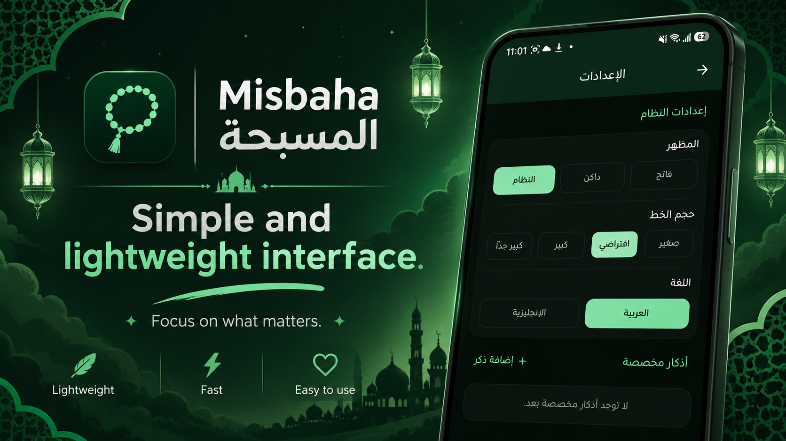
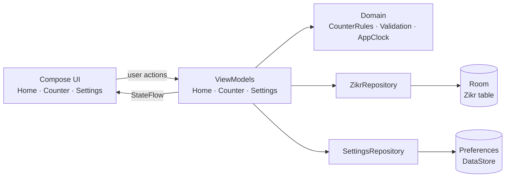

<div align="center">


# Misbaha · المسبحة

**An Arabic-first electronic tasbeeh for Android.**
Simple, fast, lightweight, and fully open source.


[Features](#-features) ·
[Screenshots](#-screenshots) ·
[Getting started](#-getting-started) ·
[Release build](#-release-apk) ·
[Architecture](#-architecture) ·
[Contributing](#-contributing)

</div>

---

## ✨ Overview

Misbaha (المسبحة) is a clean digital prayer-bead counter. No ads, no accounts, no internet permission, no clutter. You tap, it counts, and every tap is saved instantly.

It is built Arabic-first with proper RTL layouts, localized numerals, and the Tajawal typeface, while still offering a full English interface that you can switch to at any time.

## 📸 Screenshots

<div align="center">

</div>

## 🌟 Features

### Counting

- 📿 **Built-in adhkar** in a fixed order: سبحان الله، الحمد لله، الله أكبر، لا إله إلا الله، أستغفر الله، اللهم صل على محمد وآل محمد، تسبيح الزهراء (عليها السلام)
- ♾️ **Limitless standard counter** with a permanent total and a *today* count that resets at local midnight
- 🌿 **Dedicated Zahra counter** with three phases of 33, a progress ring, phase and full-cycle feedback, and in-progress state that survives app restarts
- 💾 **Instant persistence**: every tap is written immediately through a single-writer coroutine channel, so rapid taps never overwrite each other

### Personalization

- ✍️ **Custom adhkar** with add, edit, and delete, empty and duplicate validation, and long-text handling
- 🎨 **Theme**: Light, Dark, or System
- 🔠 **Font size**: Small, Default, Large, or Extra large
- 🌍 **Language**: Arabic or English, applied immediately with no restart
- 📅 **Hijri date** shown on the home screen

### Polish

- 🌗 Light and dark palettes built around a single green accent
- 🔤 Bundled **Tajawal** Arabic font (Regular, Medium, Bold)
- 🧩 Adaptive launcher icon with a **monochrome** (themed icon) variant
- 🚀 Android **SplashScreen API** support
- ☁️ Backup and data extraction rules, so counts, custom adhkar, and settings survive device backup and restore
- ✅ Unit tests for counter limits, midnight reset, and Zahra progression

## 🧰 Tech stack

| Area | Choice |
| --- | --- |
| Language | Kotlin 2.4 |
| UI | Jetpack Compose + Material 3 |
| Navigation | Navigation Compose |
| Database | Room (with KSP) |
| Settings | Preferences DataStore |
| Async | Kotlin Coroutines + `StateFlow` |
| Architecture | MVVM, unidirectional data flow, manual DI |
| Localization | `AppCompatDelegate` per-app locales |
| Build | Gradle 9.6 (wrapper included), AGP 9.5, version catalog |
| Testing | JUnit 4 + `kotlinx-coroutines-test` |

## 🚀 Getting started

### Requirements

- Windows, macOS, or Linux
- Android Studio with support for Android Gradle Plugin 9.5.1
- JDK 17 or newer
- Android SDK Platform 37 and Build Tools 36.0.0
- An Android device or emulator running **Android 8.0 (API 26)** or newer

The project uses Gradle 9.6.0 through the included wrapper, so you do not need a separate Gradle installation.

### Open the project

1. Clone the repository (or download and extract the ZIP):

   ```bash
   git clone https://github.com/<your-username>/Misbaha.git
   ```

2. Open Android Studio and choose **File → Open**, then select the project root.
3. Let Android Studio sync and download dependencies.
4. Make sure the SDK location is configured. Android Studio usually creates `local.properties` for you. If not, create it in the project root:

   ```properties
   # Windows
   sdk.dir=C\:\\Users\\<user>\\AppData\\Local\\Android\\Sdk

   # macOS / Linux
   sdk.dir=/Users/<user>/Library/Android/sdk
   ```

   `local.properties` is machine-specific and ignored by Git.

### Build and run

From Android Studio, select the `app` configuration and press **Run** ▶️

Or from a terminal in the project root:

<details open>
<summary><b>Windows (PowerShell)</b></summary>

```powershell
$env:JAVA_HOME = "C:\Program Files\Android\Android Studio\jbr"
.\gradlew.bat assembleDebug
adb install -r app\build\outputs\apk\debug\app-debug.apk
```

</details>

<details>
<summary><b>macOS / Linux</b></summary>

```bash
export JAVA_HOME="/Applications/Android Studio.app/Contents/jbr/Contents/Home"
./gradlew assembleDebug
adb install -r app/build/outputs/apk/debug/app-debug.apk
```

</details>

The debug APK is written to `app/build/outputs/apk/debug/app-debug.apk`.

### Tests and lint

```bash
./gradlew testDebugUnitTest
./gradlew lintDebug
```

On Windows use `.\gradlew.bat` instead of `./gradlew`.

The unit tests cover:

- Unbounded growth of the standard total count
- Today-count reset when the stored date is before the local date
- Zahra phase advancement at 33
- Zahra cycle completion and wrap-around to phase zero
- Persisted in-progress Zahra phase and count

## 📦 Release APK

### Option 1: Debug-signed release build

If `keystore.properties` is absent, the release build falls back to the debug signing key so the APK stays installable for testing:

```bash
./gradlew assembleRelease
```

Output: `app/build/outputs/apk/release/app-release.apk`

> ⚠️ This fallback is handy for local verification but is **not** suitable for distribution.

### Option 2: Signed release build

1. Create a keystore:

   ```bash
   keytool -genkeypair -v -keystore misbaha-release.jks -alias misbaha -keyalg RSA -keysize 4096 -validity 10000
   ```

2. Create `keystore.properties` in the project root:

   ```properties
   storeFile=misbaha-release.jks
   storePassword=YOUR_STORE_PASSWORD
   keyAlias=misbaha
   keyPassword=YOUR_KEY_PASSWORD
   ```

   `storeFile` is resolved relative to the project root.

3. Build the signed APK:

   ```bash
   ./gradlew assembleRelease
   ```

4. Verify the signature:

   ```bash
   apksigner verify --verbose app/build/outputs/apk/release/app-release.apk
   ```

> 🔐 Keep `keystore.properties`, `*.jks`, and `*.keystore` private. They are already listed in `.gitignore`.

Minification and resource shrinking are currently **disabled** in the release build. If you enable them, keep the existing `proguard-rules.pro` and re-test Room, DataStore, and Compose behavior.

## 🏗️ Architecture

Misbaha follows **MVVM** with unidirectional data flow and manual dependency injection.



| Layer | Responsibility |
| --- | --- |
| **UI** | Compose screens collect `StateFlow` from ViewModels and send user actions back as function calls. |
| **ViewModels** | `HomeViewModel`, `CounterViewModel`, and `SettingsViewModel` expose immutable UI state. |
| **Domain** | `CounterRules` holds the pure counting logic, including midnight handling and Zahra phase transitions. |
| **Data** | `ZikrRepository` owns Room transactions. `SettingsRepository` owns DataStore preferences. |
| **DI** | `AppContainer` is created by `MisbahaApplication` and supplies repositories, the database, and the clock. `AppViewModelProvider` builds ViewModels from it. |

**Storage design.** Room keeps built-in and custom adhkar in a single table. Standard adhkar use `totalCount` and `todayCount`. The Zahra row uses `totalCount` for completed cycles, `todayCount` for cycles completed today, and separate phase fields for in-progress state. This keeps list ordering and updates uniform.

**Locale handling.** Language is applied through `AppCompatDelegate.setApplicationLocales`, with `AppLocalesMetadataHolderService` enabled so the choice is stored automatically. Arabic is the default on first launch.

### Counting behavior

- Every tap updates the UI immediately and is persisted through a single-writer coroutine channel.
- Standard counters have **no upper limit**.
- The today count is compared against the stored local date. When the date changes, today starts again at zero while the total stays untouched.
- Zahra counts **33 taps per phase across three phases**. Completing the third phase adds one full cycle to the total and today count, then returns to phase zero.
- Reset clears the total, today count, and any in-progress Zahra phase, after confirmation.

### Project structure

```text
Misbaha/
├── app/
│   └── src/
│       ├── main/
│       │   ├── java/com/misbaha/app/
│       │   │   ├── data/          # Room, DataStore, repositories
│       │   │   ├── di/            # AppContainer (manual DI)
│       │   │   ├── domain/        # Models, counter rules, validation, clock
│       │   │   └── ui/            # Compose screens, components, theme, navigation
│       │   └── res/               # Strings (en + ar), fonts, drawables, icons
│       └── test/                  # Unit tests (CounterRulesTest)
├── docs/images/                   # README images
├── gradle/libs.versions.toml      # Version catalog
├── licenses/OFL-Tajawal.txt
└── README.md
```

<details>
<summary><b>Full source tree</b></summary>

```text
app/src/main/java/com/misbaha/app/
├── AppViewModelProvider.kt
├── MainActivity.kt
├── MisbahaApplication.kt
├── data/
│   ├── local/        MisbahaDatabase · ZikrConverters · ZikrDao · ZikrEntity
│   ├── preferences/  LocaleController · SettingsRepository
│   └── repository/   ZikrRepository
├── di/               AppContainer
├── domain/
│   ├── counter/      CounterRules
│   ├── model/        AppSettings · Zikr · ZikrType
│   ├── time/         AppClock
│   └── validation/   ZikrTextValidator
└── ui/
    ├── components/   ConfirmDialog · CounterCircle · CounterStats · MisbahaTopBar
    │                 SegmentedSelector · ZikrCard · ZikrFormDialog
    ├── counter/      CounterScreen · CounterViewModel
    ├── home/         HomeDrawer · HomeScreen · HomeViewModel
    ├── navigation/   MisbahaNavHost
    ├── settings/     SettingsScreen · SettingsViewModel
    ├── theme/        Color · Dimens · Theme · Type
    └── util/         LastUsedFormatter · SystemBars · TextFormatting
```

</details>

## 🌍 Localization

English strings are the base values and Arabic lives in `values-ar`. On first launch the app picks Arabic. Changing the language in Settings updates the interface immediately and persists across launches. All layouts use start and end alignment, so both RTL and LTR render correctly.

Want to add a language? Add a `values-<code>` folder with a translated `strings.xml` and register the locale in `res/xml/locales_config.xml`.

## 🤝 Contributing

Contributions are welcome. Bug reports, translations, and pull requests all help.

1. Fork the repo and create a branch: `git checkout -b feature/my-change`
2. Make your changes and run `./gradlew testDebugUnitTest lintDebug`
3. Commit with a clear message and open a pull request

Please keep the app lightweight and focused. No ads, trackers, or unnecessary permissions.

## 🔤 Fonts and licenses

The app bundles the **Tajawal** typeface in Regular, Medium, and Bold weights, distributed under the [SIL Open Font License 1.1](licenses/OFL-Tajawal.txt).

For the project's own source code, add a `LICENSE` file to the repository root and reference it here.

---

<div align="center">

Made with 💚 for the Ummah

*Focus on what matters.*

</div>
